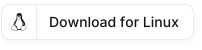

[![][image-banner]][releases-link]

GaGaDown 是一个专为速度设计、UI 美观的桌面下载器，原生支持 Windows 与 Linux。

它通过专门的动态分段与多线程算法接管浏览器下载任务。自动测速，自动换线，自动接管慢速任务。

<a href="https://github.com/shuakami/gagadown/releases/latest/download/GagaDown-windows-setup.exe"></a>
<a href="https://github.com/shuakami/gagadown/releases/latest/download/GagaDown-linux-x86_64.tar.gz"></a>

**[下载][releases-link]** **[反馈问题][issues-link]** **[隐私政策][privacy-link]**

[![][github-release-shield]][releases-link]
[![][github-downloads-shield]][releases-link]
[![][github-stars-shield]][stars-link]
[![][github-license-shield]][license-link]

## 特性

- **专研分段与多线程算法**：将文件动态切分，多线程并发下载。先下完的线程会自动接管最慢的分段，解决最后 1% 卡死的问题。
- **跨平台**：提供 Windows 与 Linux（X11 / Wayland）原生支持。
- **智能线路竞速**：直连、系统代理、本地代理并发测速。哪条线路快就用哪条，并自动记忆域名的最佳策略。
- **连接数自适应**：边下边测速。速度能涨就增加并发，遇到限流自动退让，下次下载直接复用最佳配置。
- **可靠续传**：基于实际落盘进度与 `If-Range` 校验。服务端文件若发生变化会自动重新下载，确保文件完整。
- **精准接管**：探测到网页、登录鉴权或错误码时，自动将任务交还给浏览器，不盲目下载。
- **浏览器扩展**：Chrome 可从网上应用店安装，Edge 提供内置插件。GaGaDown 未启动时，浏览器原生下载照常工作。
- **安静运行**：Windows 与支持 StatusNotifier 托盘的 Linux 桌面可将主窗口收到托盘。开机静默启动和下载完成通知目前仅支持 Windows。
- **界面锐利**：Windows 端接入系统级 ClearType 字体渲染，文字显示清晰。

## 快速开始

### Windows

1. 从 [Releases][releases-link] 下载 `GagaDown-Setup-x.y.z.exe` 并安装。也提供免安装的 `portable` 便携版。
2. 打开 GaGaDown，在「浏览器插件」页按步骤将插件安装至 Chrome 或 Edge。
3. 在浏览器中正常点击下载即可。

### Linux

```bash
tar xzf GagaDown-*-linux-x86_64.tar.gz
cd GagaDown-*-linux-x86_64
./GagaDown
```

需要 Vulkan 或 OpenGL 显卡驱动，X11 和 Wayland 均可运行。

### Flatpak

Flatpak 支持目前为预览。安装 `flatpak-builder` 后，可在仓库根目录从 manifest 构建并安装到当前用户：

```bash
flatpak-builder --user --install-deps-from=flathub --install --force-clean \
  target/flatpak-build packaging/flatpak/io.github.shuakami.GaGaDown.yml
flatpak run io.github.shuakami.GaGaDown
```

上述命令需要已配置名为 `flathub` 的远程源以安装构建依赖。当前 manifest 使用 Freedesktop `25.08`，固定到 `v0.1.7` 的源码归档并应用 `gagadown-linux.patch`；更新源码 tag 时，也要同步检查 SHA-256、补丁和 `cargo-sources.json`。

Flatpak 默认可访问系统下载目录，其他目录可通过系统文件选择器授权。打开扩展商店会交给系统默认浏览器。此预览包强制使用 X11，在 Wayland 桌面通过 XWayland 运行。

### 浏览器插件

**Chrome**：在 GaGaDown 的「浏览器插件」页选择 Google Chrome，点击「打开商店」，从 [Chrome 网上应用店][chrome-extension-link] 添加 GaGaDown，无需开启开发者模式。

**Edge**：暂时使用手动安装。在 GaGaDown 的「浏览器插件」页选择 Microsoft Edge，点击「安装插件」。在浏览器地址栏打开 `edge://extensions`，开启「开发人员模式」，点击「加载解压缩的扩展」，选择 GaGaDown 数据目录下的 `extension` 文件夹。插件页可复制该路径。

安装后，在 GaGaDown 的插件页复制「本机 API 配对码」，打开浏览器的 GaGaDown 扩展弹窗，粘贴并点击「保存配对码」。配对成功后，先按提示单独授权浏览器权限，再阅读数据处理说明、勾选同意并点击「同意并启用」。若浏览器在授权期间关闭扩展面板，重新打开后会从权限授权后的步骤继续；未同意前不会接管下载。

如果之前通过开发者模式安装过 Chrome 插件，请先停用或移除旧的未打包版本，再安装商店版本并重新配对，避免两份插件同时接管下载。商店版本后续由 Chrome 自动更新。

### 命令行

```bash
gagadown-cli get <URL> [--dir DIR] [--max-connections N] [--proxy URL] [--direct-only] [--sha256 HEX]
gagadown-cli serve
gagadown-cli proxies
```

## 从源码构建

```bash
# Linux
cargo build --release -p gagadown-app -p gagadown-cli

# Windows（在 Linux 上交叉编译，需要 mingw-w64、nsis、zip）
bash tools/package.sh
```

| 目录 | 内容 |
| --- | --- |
| `crates/gagadown-core` | 下载引擎、线路选择、任务管理、本地 API |
| `crates/gagadown-app` | 桌面程序（egui + wgpu） |
| `crates/gagadown-cli` | 命令行 |
| `extension` | 浏览器插件（Chrome / Edge，MV3） |
| `patches` | eframe / epaint / egui-wgpu 的本地补丁 |

推送到 `main` 后，GitHub Actions 会自动更新版本号、打 tag，并编译发布 Windows 与 Linux 的 Release。

## 许可证

[GPL-3.0][license-link]

## Known issue

Linux 曾有两类小窗卡顿，均已修复：主窗口位于不可见工作区时 vsync 呈现阻塞（改为优先 Mailbox/Immediate 并按显示器刷新率限帧），以及主窗口隐藏到托盘后隐藏窗口重绘饿死事件循环（改为隐藏窗口延迟绘制）。Linux 版本默认走 X11/XWayland（原生 Wayland 无法可靠实现关闭到托盘），调试原生 Wayland 可用 `GAGADOWN_FORCE_WAYLAND=1`。

诊断默认关闭。使用包含诊断代码的构建复现时，先正常退出已有实例，再按需开启。日志与普通应用输出分离，写入数据目录的 `ui-debug.log`；每次启用时会重新创建该日志文件：

```bash
# Flatpak
flatpak run --env=GAGADOWN_UI_TRACE=1 io.github.shuakami.GaGaDown
# Flatpak 日志位于 ~/.var/app/io.github.shuakami.GaGaDown/data/gagadown/ui-debug.log
# 本地构建（Linux 默认即 X11/XWayland；调试原生 Wayland 可加 GAGADOWN_FORCE_WAYLAND=1）
GAGADOWN_UI_TRACE=1 ./target/release/GagaDown
# 本地日志位于 $XDG_DATA_HOME/gagadown/ui-debug.log（通常为 ~/.local/share/gagadown/ui-debug.log）
```

抓取一段从主窗口在前台到切换工作区或退到托盘、随后小窗卡顿的日志，并记下触发时刻。诊断记录窗口事件处理、重绘调度、弹窗 UI/surface/绘制耗时，以及 GPU acquire、submit 和 present 阶段；日志异步写盘，避免文件 I/O 阻塞 UI 事件线程。不记录下载 URL 或文件名。

<!-- LINK GROUP -->

[image-banner]: docs/images/banner.png
[releases-link]: https://github.com/shuakami/gagadown/releases
[issues-link]: https://github.com/shuakami/gagadown/issues
[privacy-link]: docs/privacy-policy.md
[chrome-extension-link]: https://chromewebstore.google.com/detail/dchaceihdgmmblaalchfafmnalhjpiip
[stars-link]: https://github.com/shuakami/gagadown/stargazers
[license-link]: LICENSE
[github-release-shield]: https://img.shields.io/github/v/release/shuakami/gagadown?color=317cfe&labelColor=black&logo=github&style=flat-square
[github-downloads-shield]: https://img.shields.io/github/downloads/shuakami/gagadown/total?color=317cfe&labelColor=black&style=flat-square
[github-stars-shield]: https://img.shields.io/github/stars/shuakami/gagadown?color=317cfe&labelColor=black&style=flat-square
[github-license-shield]: https://img.shields.io/badge/license-GPL--3.0-317cfe?labelColor=black&style=flat-square
